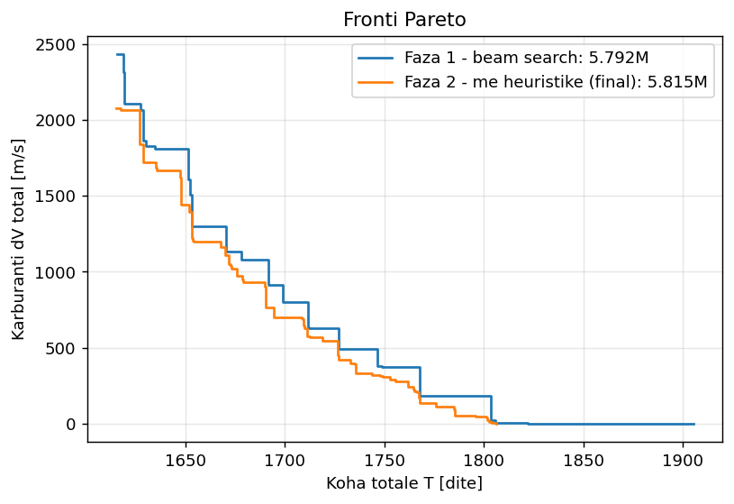

# Trappist Tour – ESA Space Optimisation Competition 2022

Projekt për lëndën **Design & Analysis of Algorithms**.

Problemi ([ESA SpOC 2022 – Trappist Tour](https://optimize.esa.int/challenge/spoc-trappist-tour/p/trappist-tour)):
një anije hyn në sistemin TRAPPIST-1 dhe viziton të 7 planetët duke përdorur gravitetin e tyre
(fly-by). Minimizohen njëkohësisht **karburanti (ΔV)** dhe **koha (T)**. Score-i është
**hypervolume** i frontit Pareto të ≤ 100 zgjidhjeve.

## Rezultati

**Hypervolume = 5,814,770**, i verifikuar me kodin zyrtar të ESA-s: 100 tura, të gjitha të vlefshme.

| | Hypervolume |
|---|---:|
| Vendi i 1-rë i garës | 5,870,436 |
| **Ky projekt** | **5,814,770** (99.05% e rekordit) |
| Vendi i 2-të i garës | ~5.73M |
| Vendi i 3-të i garës | ~5.60M |
| Pikënisja jonë (algoritme evolucionare, faza 0) | 2.33M |

Dorëzimi: [`submission/best_submission.json`](submission/best_submission.json)



## Ideja kryesore
1. **Analiza fizike:** fly-by-i i parë e kap anijen në orbitë me periudhë ≥ ~134 ditë. Pas
   çdo fly-by-i orbita shkurtohet, prandaj problemi ndahet natyrshëm **këmbë pas këmbe**.
2. **Beam search:** problemi 34-D zbërthehet në probleme 4-D (një këmbë në kohë), të zgjidhura
   me Nelder–Mead nga fillime të rastit dhe "fizike".
3. **Heuristikë si A\*:** koha e mbetur e turës parashikohet nga periudha minimale e orbitës.
   Beam-i rendit sipas `ΔV + λ·(t + h)`. Me të njëjtat cilësime: 5.660M → 5.772M.
4. **Dorëzimi:** verifikim zyrtar i çdo ture dhe zgjedhje optimale e 100 pikave me programim dinamik.

Rrugëtimi i plotë nga 2.33M në 5.815M, me vlerat e çdo faze dhe eksperimentet që nuk funksionuan:
[`docs/PROCESI.md`](docs/PROCESI.md). Detajet e algoritmit dhe kompleksiteti:
[`docs/METODA.md`](docs/METODA.md).

## Struktura
```
submission/best_submission.json   dorëzimi final (formati i ESA-s)
src/evaluator.py         vlerësuesi i shpejtë (numba) i problemit
src/entry.py             këmba e hyrjes nga 10 AU
src/leg_optimizer.py     optimizimi i një këmbe (Nelder–Mead + fillime fizike)
src/heuristic.py         heuristika për të ardhmen (P_min, h)
src/beam_search.py       beam search këmbë pas këmbe
src/suffix_reopt.py      rioptimizimi i fundit të turës
src/hypervolume.py       hypervolume, verifikimi zyrtar, zgjedhja optimale e 100 pikave
src/run_search.py        kërkimi i gjatë (cikël run-esh)
src/merge_final.py       krijimi i dorëzimit final nga të gjitha run-et
src/verify_submission.py kontrolli i dorëzimit me kodin zyrtar
src/official.py          kodi zyrtar i vlerësimit të ESA-s (i pandryshuar)
src/seed_archive.npy     arkivi i turave më të mira (pikënisja për kërkime të reja)
tests/test_evaluator.py  testet: vlerësuesi kundrejt kodit zyrtar, vlefshmëria e dorëzimit
docs/                    procesi, metoda, grafikët
```

## Si ekzekutohet
`pykep 2.6` instalohet vetëm nga conda-forge (p.sh. me Miniforge):
```
conda env create -f environment.yml
conda activate trappist
cd src
```
| Qëllimi | Komanda | Koha |
|---|---|---|
| Verifikimi i score-it | `python verify_submission.py` | ~1 min |
| Testet | `python ../tests/test_evaluator.py` | ~1 min |
| Kërkim i ri | `python run_search.py --hours 20` | sa orë të duash |
| Dorëzimi nga run-et | `python merge_final.py` | ~2 min |

Kërkimi ka elemente të rastit: një run i ri jep rezultat të ngjashëm, jo identik.
`merge_final.py` e zëvendëson dorëzimin vetëm nëse rezultati i ri është më i mirë.

## Autori dhe përdorimi i AI-së
**Blert Sylejmani.** Projekti u zhvillua me ndihmën e asistentëve AI për shkrimin e kodit, nën drejtimin
tim: përcaktimi i qëllimeve, zgjedhja e qasjeve, ekzekutimi dhe vlerësimi i eksperimenteve, dhe
vendimet se çfarë ruhet dhe çfarë hidhet poshtë u morën nga unë. Procesi i plotë, përfshirë provat që
nuk funksionuan, është i dokumentuar në [`docs/PROCESI.md`](docs/PROCESI.md).
