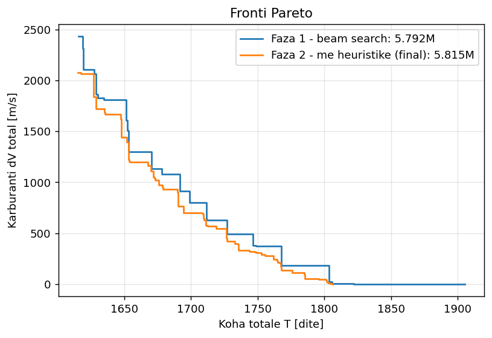
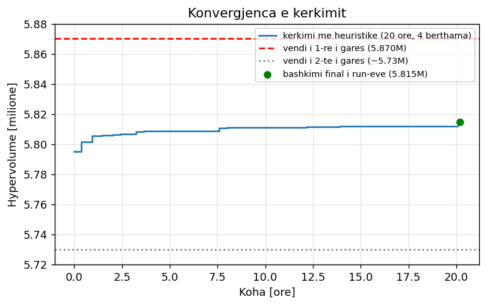

# Metoda

## 1. Problemi
- **Vektori i vendimeve (34 numra):** `[u, v, T0]` = drejtimi i nisjes nga sfera 10 AU dhe kohëzgjatja
  e hyrjes; 6 blloqe `[β, rp, η, T]` = fly-by-i (orientimi, distanca), momenti i manovrës (pjesë e
  kohës) dhe kohëzgjatja e çdo këmbe; 7 numra = radha e planetëve (permutacion i b..h).
- **Objektivat:** ΔV total [m/s] dhe koha totale T [ditë], të dyja për t'u minimizuar.
- **Kufizimet:** anija s'duhet t'i afrohet yllit nën 834,840 km; çdo këmbë zgjat ≥ 5 ditë.
- **Score:** hypervolume i ≤ 100 zgjidhjeve, me pikë referimi (2500 m/s, 4000 ditë).

## 2. Fronti Pareto dhe hypervolume
Karburanti dhe koha bien ndesh: turë më e shpejtë kushton më shumë karburant. Zgjidhjet ku
asnjë objektiv nuk përmirësohet pa përkeqësuar tjetrin formojnë **frontin Pareto**. Hypervolume
është sipërfaqja midis frontit dhe pikës së referimit; sa më afër këndit (0, 0) fronti, aq më i lartë score-i.

## 3. Algoritmi

### 3.1 Vlerësuesi i shpejtë – `evaluator.py`
Rishkrim me numba i funksionit zyrtar: efemeridat Kepleriane, problemi i Lambert-it (Izzo),
propagimi i orbitës, fly-by-i dhe kontrolli i distancës nga ylli. Rreth 4 herë më i shpejtë se pykep;
testi `tests/test_evaluator.py` e krahason me kodin zyrtar (gabim maksimal ~1e-9).

### 3.2 Hyrja – `entry.py`
Për çdo drejtim (u, v), T0 zgjidhet me skanim + prerje të artë, që ΔV_init ≈ 0 (~1500 ditë).

### 3.3 Optimizimi i një këmbe – `leg_optimizer.py`
Problemi 34-D zbërthehet në probleme 4-D: për këmbën p → q optimizohen (β, log rp, η, T) me
**Nelder–Mead**, nga dy burime fillimesh:
- **të rastit** (secili fillim = më i miri nga 30 pika të rastit), në 10 dritare kohore;
- **"fizike"**: për çdo (β, rp) llogaritet orbita pas fly-by-it, momentet kur ajo pret rrezen e
  orbitës së q dhe kur planeti q ndodhet aty. ΔV(T) ka lugina shumë të ngushta (~1 ditë) që
  fillimet e rastit shpesh i humbasin.

### 3.4 Beam search me heuristikë – `beam_search.py`, `heuristic.py`
- **Gjendja:** sekuenca deri tani, koha, shpejtësia e mbërritjes, ΔV i grumbulluar.
- **Zgjerimi:** për çdo planet të pavizituar ruhen 1–2 këmbët më të mira në secilën nga 28 dritaret
  kohore të imta. Kështu ruhet kompromisi ΔV kundrejt T.
- **Heuristika (si A\*):** `h(k, P_min) = a_k + b_k · P_min`, ku P_min është periudha më e shkurtër
  e orbitës që mund të japë fly-by-i. Parashikon kohën e mbetur të turës.
- **Përzgjedhja:** 60% e beam-it sipas `ΔV + λ·(t + h)`, 40% sipas `ΔV + λ·t` (diversitet), për 10
  vlera λ ∈ [0.3, 25] m/s/ditë. Secila λ përfaqëson një pikë tjetër të frontit Pareto.
- **Hyrjet:** gjysma me kapjen më të mirë (P_min më i vogël), gjysma të rastit.

### 3.5 Rioptimizimi i fundit të turës – `suffix_reopt.py`
Për turat me kontributin më të madh në hypervolume mbahen fikse 1–3 planetët e parë dhe kërkohen
më dendur këmbët e mbetura.

### 3.6 Kërkimi i gjatë dhe dorëzimi – `run_search.py`, `merge_final.py`, `hypervolume.py`
- `run_search.py` përsërit kërkimin me konfigurime të ndryshme dhe e ruan çdo rezultat.
- **Fronti i vlefshëm:** çdo kandidat i frontit kontrollohet me kodin zyrtar; të pavlefshmit hiqen dhe
  fronti rillogaritet derisa të jetë i gjithi i vlefshëm.
- **Zgjedhja optimale e 100 pikave** me programim dinamik:
  `f[c][j] = max_{i<j} f[c−1][i] + (4000 − T_j)(ΔV_i − ΔV_j)`, kompleksitet O(n · m²).

## 4. Kompleksiteti
| Pjesa | Kompleksiteti | Koha reale |
|---|---|---|
| Vlerësimi i një ture | O(1) (7 Lambert + propagime) | ~20–40 µs |
| Optimizimi i një këmbe | O(S · I), S fillime, I iteracione NM | ~10–50 ms |
| Beam search | O(6 · B · (7−k) · S · I) | 15–40 min (B = 400–800, 4 bërthama) |
| Heuristika | O(B · 576) fly-by për nivel | e papërfillshme |
| Zgjedhja e 100 pikave | grykëse O(m² log m); e saktë O(n · m²) | sekonda |

Beam search-i është heuristikë pa garanci optimaliteti global, por shfrytëzon strukturën e problemit
(dekompozimin në këmbë) dhe fizikën e kapjes gravitacionale.

## 5. Konvergjenca

